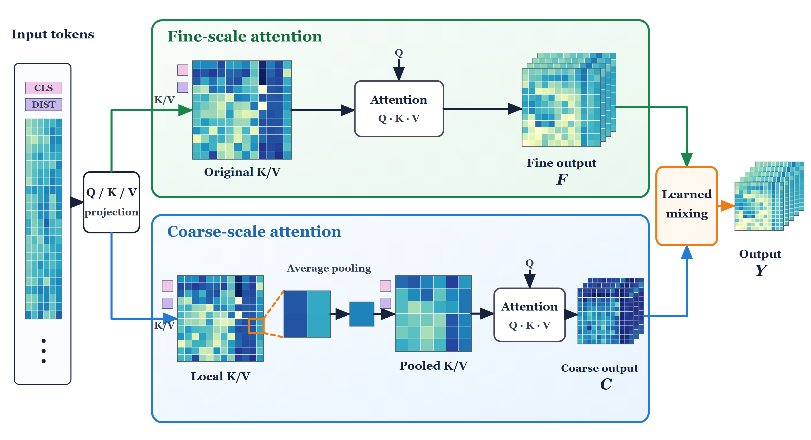

# ResAST

Code for three-class feline age-group classification from vocalisations: kitten, adult and senior. ResAST combines a frozen Audio Spectrogram Transformer with multiscale attention and a bounded residual generated from 20 acoustic descriptors.

## Model



The two branches share queries and use original or locally pooled keys and values. Learned coefficients mix their outputs in the final two encoder blocks. The acoustic residual is added to the classification head.

Heatmaps illustrate intermediate features from one forward pass, with blue to light yellow indicating lower to higher values within each normalization group. Rear slices repeat the front slice for schematic depth. Figure provenance is recorded in [provenance.json](docs/figures/provenance.json).

## Getting started

Use Python 3.10 and run commands from this directory. The tested GPU environment uses PyTorch 2.2.2 with CUDA 12.1.

```console
python -m pip install torch==2.2.2 torchaudio==2.2.2 --index-url https://download.pytorch.org/whl/cu121
python -m pip install -c requirements/reference-constraints.txt -e ".[test]"
```

Follow the [running guide](docs/running.md) to prepare data, train a model, evaluate predictions or run the audio demo. It includes a small training example and commands for the comparison models.

The supplied configuration uses seeds 17, 43 and 101. Training settings are in [configs/paper.json](configs/paper.json); fixed data splits are in [splits/roles.csv](splits/roles.csv).

## Code

| Location | Contents |
| --- | --- |
| [src/resast/models](src/resast/models) | AST, multiscale attention, acoustic residual and classifiers |
| [src/resast/data](src/resast/data) | Audio preprocessing and acoustic features |
| [src/resast/training](src/resast/training) | Training and checkpoint handling |
| [src/resast/evaluation](src/resast/evaluation) | Metrics and probability averaging |
| [src/resast/cli](src/resast/cli) | Command-line entry points |

AST variants: `ast`, `multiscale_ast`, `ast_acoustic` and `resast`. Comparison pipelines: `vggish129`, `perch1281`, `yamnet`, `cnn14`, `aves` and `ssast`.

Run component tests with `python -m pytest -q`. Bundled reference predictions can be checked with `resast-reference --root .`.

## Sources

The data originate from [MeowAgeNet](https://github.com/aster-droide/feline-age-prediction); AST uses the Hugging Face Transformers implementation. See [THIRD_PARTY.md](THIRD_PARTY.md) for attribution and source licenses.

Audio, downloaded weights and feature caches are obtained separately. Original project code is licensed under [MIT](LICENSE); third-party materials retain their own licenses.
